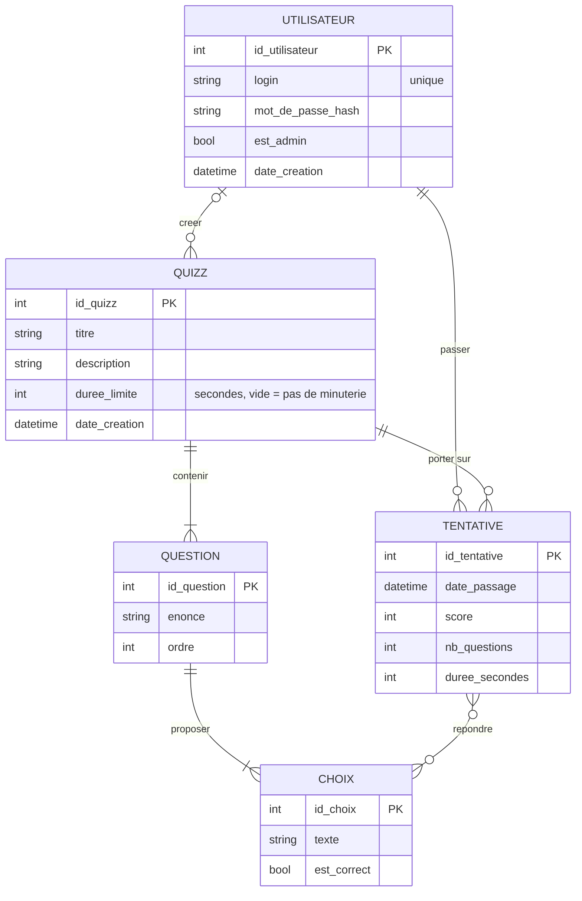

# MCD — Kwizz

Modèle conceptuel de données (méthode Merise, entité-association) de l'application Kwizz.



## Entités

| Entité | Rôle | Identifiant |
|--------|------|-------------|
| UTILISATEUR | Un compte (joueur ou administrateur) | id_utilisateur |
| QUIZZ | Une série de questions créée par un admin | id_quizz |
| QUESTION | Un énoncé appartenant à un quizz | id_question |
| CHOIX | Une réponse possible à une question, juste ou fausse | id_choix |
| TENTATIVE | Une partie jouée par un utilisateur sur un quizz, avec son score | id_tentative |

Admin et joueur ne sont pas deux entités : c'est le même UTILISATEUR avec l'attribut `est_admin`.
C'est plus simple, et un admin peut aussi jouer.

## Associations et cardinalités

Lecture : « un(e) X participe **au minimum** … et **au maximum** … fois à l'association ».

| Association | Côté 1 | Côté 2 | Justification |
|-------------|--------|--------|---------------|
| **CRÉER** | UTILISATEUR **0,n** | QUIZZ **0,1** | Un utilisateur peut créer 0 ou plusieurs quizz. Un quizz a 0 ou 1 créateur : 0 si le compte du créateur est supprimé, le quizz est alors conservé. |
| **CONTENIR** | QUIZZ **1,n** | QUESTION **1,1** | Un quizz a au moins une question. Une question appartient à un seul quizz. |
| **PROPOSER** | QUESTION **2,n** | CHOIX **1,1** | Une question propose au moins 2 choix. Un choix appartient à une seule question. |
| **PASSER** | UTILISATEUR **0,n** | TENTATIVE **1,1** | Un utilisateur peut n'avoir jamais joué ou avoir joué plusieurs fois. Une tentative est jouée par un seul utilisateur. |
| **PORTER SUR** | QUIZZ **0,n** | TENTATIVE **1,1** | Un quizz peut n'avoir jamais été joué. Une tentative concerne un seul quizz. |
| **RÉPONDRE** | TENTATIVE **0,n** | CHOIX **0,n** | Pendant une tentative, le joueur coche 0 ou plusieurs choix (plusieurs bonnes réponses sont possibles). Un choix peut être coché dans plusieurs tentatives. |

**Contraintes métier** (vérifiées par le code, pas par le MCD) :
- au moins une bonne réponse (`est_correct = vrai`) par question ;
- `login` unique ;
- le mot de passe n'est jamais stocké en clair, seulement son hachage.

## Passage au MLD (règles de transformation)

1. Chaque entité devient une table, son identifiant devient la clé primaire.
2. Une association **1,1 — x,n** disparaît : on ajoute une clé étrangère du côté **1,1**
   (ex. CONTENIR → `question.id_quizz`).
3. Une association **0,1 — 0,n** suit la même règle, avec une clé étrangère facultative
   (CRÉER → `quizz.id_createur`, qui peut être vide).
4. Une association **n,n** devient une table, avec une clé primaire composée des deux clés étrangères
   (RÉPONDRE → table `reponse`).

```text
UTILISATEUR (id_utilisateur, login, mot_de_passe_hash, est_admin, date_creation)
QUIZZ       (id_quizz, titre, description, duree_limite, date_creation, #id_createur)
QUESTION    (id_question, enonce, ordre, #id_quizz)
CHOIX       (id_choix, texte, est_correct, #id_question)
TENTATIVE   (id_tentative, date_passage, score, nb_questions, duree_secondes, #id_utilisateur, #id_quizz)
REPONSE     (#id_tentative, #id_choix)
```
Clé primaire = premier attribut (couple pour REPONSE) · `#` = clé étrangère.

Ce MLD correspond exactement au schéma SQL de `quizz/database.py`.

## Évolution prévue (sprint IA)
Ajouter `source` (manuel / fichier / ia) à QUIZZ, tâche T55. Il faudra alors mettre ce MCD à jour.
