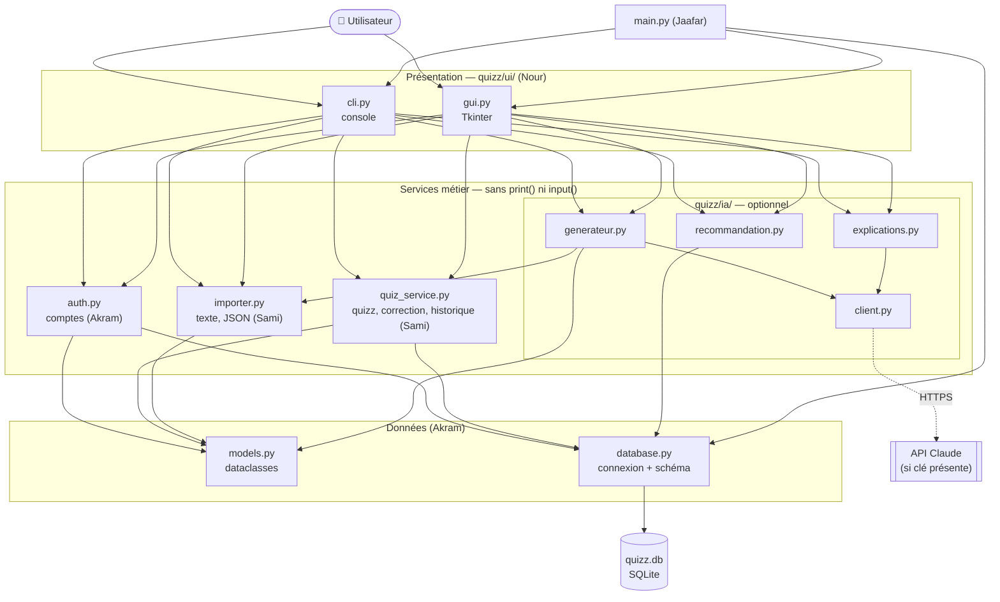

# Architecture logicielle — Kwizz

Architecture **en couches** : chaque couche n'appelle que la couche du dessous.

## Les 3 règles de l'architecture
1. **`ui/` n'écrit jamais de SQL.** L'interface appelle les services. Résultat : la console et
   l'interface graphique partagent exactement la même logique, sans code copié-collé.
2. **Les services ne font jamais de `print()` ni d'`input()`.** Ils renvoient des valeurs ou lèvent une
   exception métier (`ErreurAuth`, `ErreurQuizz`, `ErreurFormat`, `ErreurIA`). C'est ce qui les rend
   **testables** automatiquement.
3. **L'IA est un module optionnel.** Si la clé API ou le réseau manquent, `client.py` le signale et
   les écrans masquent les fonctions IA. Le reste de l'appli ne dépend pas de l'IA.

## Choix techniques et justification
| Besoin | Choix | Alternatives écartées | Pourquoi |
|--------|-------|-----------------------|----------|
| Stockage | **SQLite** (module `sqlite3`) | fichiers JSON, MySQL | inclus dans Python, aucun serveur à installer, vraies contraintes (clés étrangères, unicité) |
| Objets métier | **dataclasses** | dictionnaires, ORM (SQLAlchemy) | typés et lisibles, sans dépendance ; un ORM est trop lourd pour 6 tables |
| Mots de passe | **PBKDF2-SHA256 + sel** (`hashlib`) | MD5, bcrypt | standard, inclus dans Python ; MD5 est trop rapide à casser |
| Interface graphique | **Tkinter** | PyQt, web | inclus dans Python, suffisant pour des formulaires |
| Tests | **pytest** + base `:memory:` | unittest | syntaxe simple, une base neuve par test |
| IA | **API Claude** (SDK `anthropic`), optionnelle | modèle local (Ollama) | voir [choix-ia.md](choix-ia.md) |

## Dépendances entre modules (ordre d'intégration)
`models` → `database` → `auth` / `quiz_service` → `importer` → `ia/` → `ui/` → `main.py`.
C'est l'ordre de fusion des Pull Requests.
