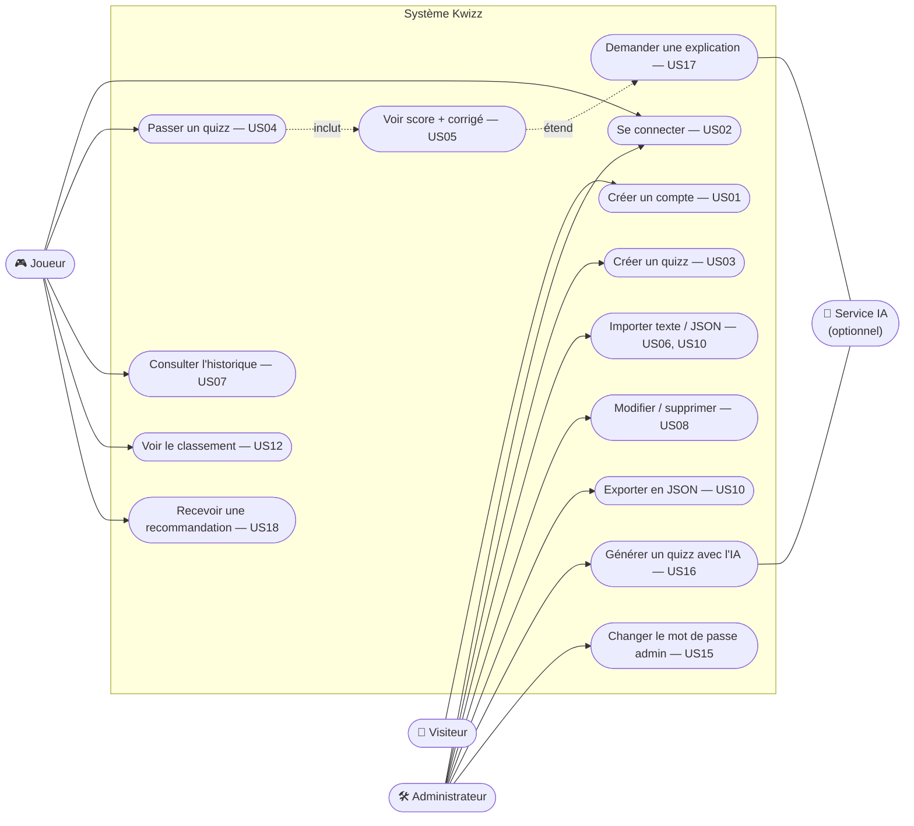

# Cas d'utilisation — Kwizz

**Lecture :**
- **Joueur** et **Administrateur** sont tous deux des utilisateurs connectés. L'administrateur peut
  aussi jouer : c'est le même compte, avec `est_admin = vrai`.
- `inclut` : passer un quizz **affiche toujours** le score et le corrigé.
- `étend` : l'explication IA est **facultative**. Elle n'existe que si l'IA est disponible.

## Description textuelle d'un cas : « Passer un quizz » (US04)
| | |
|--|--|
| **Acteur** | Joueur connecté |
| **Pré-condition** | au moins un quizz existe |
| **Scénario nominal** | 1. le joueur choisit un quizz dans la liste · 2. il choisit l'ordre (normal ou aléatoire) · 3. pour chaque question, il choisit une réponse · 4. le système corrige, enregistre la tentative et affiche le score et le corrigé |
| **Variante minuterie** | si le temps est écoulé, le quizz s'arrête et les questions sans réponse comptent comme fausses |
| **Variante IA** | le joueur demande « Pourquoi ? » sur ses erreurs (US17) |
| **Post-condition** | la tentative apparaît dans l'historique et le classement |
