# PBS — Product Breakdown Structure · Kwizz

Le **PBS** décompose **ce que l'on livre** (les produits), sans dire comment on le fabrique.
Chaque feuille est un livrable vérifiable.

```mermaid
flowchart TD
    P["<b>Projet Kwizz</b>"]

    P --> A["1. Application Kwizz"]
    P --> B["2. Documentation"]
    P --> C["3. Livrables de gestion de projet"]
    P --> D["4. Livrables de fin de projet"]

    A --> A1["1.1 Gestion des comptes<br/>inscription, connexion, admin"]
    A --> A2["1.2 Moteur de quizz<br/>création, correction, historique"]
    A --> A3["1.3 Import / export<br/>fichier texte, JSON"]
    A --> A4["1.4 Interfaces<br/>console, graphique"]
    A --> A5["1.5 Assistant IA<br/>génération, explication, recommandation"]
    A --> A6["1.6 Base de données SQLite"]
    A --> A7["1.7 Tests automatisés"]
    A --> A8["1.8 Quizz d'exemple"]

    B --> B1["2.1 README<br/>installation, utilisation"]
    B --> B2["2.2 MCD / MLD"]
    B --> B3["2.3 Architecture + cas d'utilisation"]
    B --> B4["2.4 Glossaire"]

    C --> C1["3.1 Backlog produit"]
    C --> C2["3.2 PBS / WBS"]
    C --> C3["3.3 Gantt + PERT"]
    C --> C4["3.4 Planning des sprints"]
    C --> C5["3.5 Comptes-rendus de séance"]
    C --> C6["3.6 Tableau Trello"]

    D --> D1["4.1 Rapport final"]
    D --> D2["4.2 Démonstration 15 min"]
    D --> D3["4.3 Version taguée v2.0-final"]
```

| Code | Produit | Responsable | Exigé par le sujet ? |
|------|---------|-------------|----------------------|
| 1.1 | Gestion des comptes | Akram | ✅ minimum obligatoire |
| 1.2 | Moteur de quizz | Sami | ✅ minimum obligatoire |
| 1.3 | Import texte / export JSON | Sami | ✅ texte · JSON en bonus |
| 1.4 | Interfaces console / graphique | Nour | ✅ console · GUI en bonus |
| 1.5 | Assistant IA | Sami, Akram, Nour | ➕ initiative de l'équipe |
| 1.6 | Base de données | Akram | ✅ |
| 1.7 | Tests | Nour (+ chacun pour son module) | qualité |
| 1.8 | Quizz d'exemple | Sami | démo |
| 2.x | Documentation | Nour, Akram, Sami | ✅ README, MCD, glossaire |
| 3.x | Gestion de projet | Jaafar | ✅ Gantt/PERT, PBS, WBS, sprints, CR |
| 4.x | Fin de projet | Jaafar + toute l'équipe | ✅ rapport, démo |
