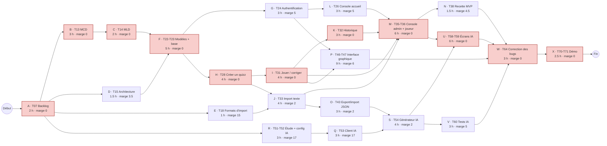

# PERT et chemin critique — Kwizz

Le réseau PERT montre **l'ordre obligatoire** des tâches (qui dépend de qui) et calcule le
**chemin critique** : la suite de tâches **sans marge**. Si l'une d'elles prend du retard, tout le
projet prend du retard.

On a gardé les 23 tâches structurantes du WBS. Les durées sont en heures de travail, tirées des
estimations du plan des sprints. Les dates (« début au plus tôt », etc.) se comptent en heures depuis le
début du projet, en supposant que les tâches indépendantes avancent en parallèle (4 personnes).

🔴 en rouge : les tâches critiques.

## Tableau de calcul

| Code | Tâche | Durée (h) | Antécédents | Début + tôt | Fin + tôt | Début + tard | Fin + tard | Marge | Critique |
|------|-------|-----------|-------------|-------------|-----------|--------------|------------|-------|----------|
| A | T07 Backlog | 2 | — | 0 | 2 | 0 | 2 | 0 | 🔴 |
| B | T13 MCD | 3 | A | 2 | 5 | 2 | 5 | 0 | 🔴 |
| C | T14 MLD | 2 | B | 5 | 7 | 5 | 7 | 0 | 🔴 |
| D | T15 Architecture | 1.5 | A | 2 | 3.5 | 5.5 | 7 | 3.5 |  |
| E | T18 Formats d'import | 1 | A | 2 | 3 | 17 | 18 | 15 |  |
| F | T22-T23 Modèles + base | 5 | C, D | 7 | 12 | 7 | 12 | 0 | 🔴 |
| G | T24 Authentification | 3 | F | 12 | 15 | 17 | 20 | 5 |  |
| H | T28 Créer un quizz | 4 | F | 12 | 16 | 12 | 16 | 0 | 🔴 |
| I | T31 Jouer / corriger | 4 | H | 16 | 20 | 16 | 20 | 0 | 🔴 |
| J | T33 Import texte | 4 | E, H | 16 | 20 | 18 | 22 | 2 |  |
| K | T32 Historique | 3 | I | 20 | 23 | 20 | 23 | 0 | 🔴 |
| L | T26 Console accueil | 3 | G | 15 | 18 | 20 | 23 | 5 |  |
| M | T35-T36 Console admin + joueur | 6 | I, J, K, L | 23 | 29 | 23 | 29 | 0 | 🔴 |
| N | T38 Recette MVP | 1.5 | M | 29 | 30.5 | 33.5 | 35 | 4.5 |  |
| O | T43 Export/import JSON | 3 | J | 20 | 23 | 22 | 25 | 2 |  |
| P | T46-T47 Interface graphique | 9 | G, I | 20 | 29 | 26 | 35 | 6 |  |
| R | T51-T52 Étude + config IA | 3 | A | 2 | 5 | 19 | 22 | 17 |  |
| Q | T53 Client IA | 3 | R | 5 | 8 | 22 | 25 | 17 |  |
| S | T54 Générateur IA | 4 | Q, O | 23 | 27 | 25 | 29 | 2 |  |
| U | T58-T59 Écrans IA | 6 | S, M | 29 | 35 | 29 | 35 | 0 | 🔴 |
| V | T60 Tests IA | 3 | S | 27 | 30 | 32 | 35 | 5 |  |
| W | T64 Correction des bugs | 3 | N, P, U, V | 35 | 38 | 35 | 38 | 0 | 🔴 |
| X | T70-T71 Démo | 2.5 | W | 38 | 40.5 | 38 | 40.5 | 0 | 🔴 |

**Comment lire une ligne :**
- *début au plus tôt* = la fin la plus tardive des antécédents ;
- *fin au plus tard* = le début au plus tard le plus précoce des successeurs ;
- *marge* = début au plus tard − début au plus tôt.

## Résultat

- **Durée minimale du projet : 40,5 h de travail** sur le chemin critique.
- **Chemin critique :**
  Backlog → MCD → MLD → Modèles + base → Créer un quizz → Jouer/corriger → Historique →
  Console admin/joueur → Écrans IA → Bugs → Démo.

## Ce que ça change pour l'équipe (décisions du PO)
1. **Akram est sur le chemin critique dès le début** (MCD → MLD → base) : ses tâches passent en premier,
   et on ne lui confie rien d'autre en S2–S3.
2. **Sami ensuite** (créer, jouer, corriger) : c'est pour ça que ses PR sont fusionnées juste après
   celles d'Akram.
3. **L'interface graphique a 6 h de marge** : un retard sur la GUI ne retarde pas la démo. C'est donc la
   première chose à réduire en cas de problème.
4. **Les écrans IA sont critiques en fin de projet** : l'étude IA (R, 17 h de marge) peut commencer dès
   qu'il y a un moment libre. Attention en revanche au **générateur IA (S, 2 h de marge)** : il attend
   l'export JSON (O), qui doit donc être prêt avant S6.

Ce calcul est refait à chaque compte-rendu si une tâche critique prend du retard (rapport, partie B :
suivi de l'avancement).
