# WBS — Work Breakdown Structure · Kwizz

Le **WBS** décompose **le travail à faire** en lots, puis en tâches, avec au maximum 2 jours par tâche
(règle du sujet). Chaque tâche porte son identifiant `Txx`, le même que dans `plan-sprints.md` et
dans Trello.

```mermaid
flowchart TD
    W["<b>Projet Kwizz</b>"]
    W --> L1["1. Pilotage"]
    W --> L2["2. Conception"]
    W --> L3["3. Données & comptes"]
    W --> L4["4. Moteur de quizz"]
    W --> L5["5. Interfaces & tests"]
    W --> L6["6. Assistant IA"]
    W --> L7["7. Clôture"]

    L1 --> L11["1.1 Lancement<br/>T01–T07"]
    L1 --> L12["1.2 Planification<br/>T09–T12, T19"]
    L1 --> L13["1.3 Suivi des séances<br/>CR, mails, rétros"]
    L1 --> L14["1.4 Intégration & recette<br/>T29, T38, T39"]

    L2 --> L21["2.1 MCD / MLD<br/>T13, T14"]
    L2 --> L22["2.2 Architecture<br/>T15"]
    L2 --> L23["2.3 Cas d'utilisation, maquettes<br/>T16, T17, T20"]
    L2 --> L24["2.4 Formats d'import<br/>T18"]

    L3 --> L31["3.1 Modèles + base<br/>T22, T23"]
    L3 --> L32["3.2 Authentification<br/>T24"]
    L3 --> L33["3.3 Historique, classement<br/>T32, T44"]

    L4 --> L41["4.1 Créer / modifier / supprimer<br/>T28, T41"]
    L4 --> L42["4.2 Jouer et corriger<br/>T31"]
    L4 --> L43["4.3 Import / export<br/>T33, T43"]
    L4 --> L44["4.4 Minuterie, aléatoire<br/>T42, T45"]

    L5 --> L51["5.1 Console<br/>T26, T35, T36"]
    L5 --> L52["5.2 Interface graphique<br/>T46, T47"]
    L5 --> L53["5.3 Tests<br/>T25, T37, T48"]

    L6 --> L61["6.1 Étude et config<br/>T51, T52"]
    L6 --> L62["6.2 Services IA<br/>T53–T57, T61"]
    L6 --> L63["6.3 Écrans + tests IA<br/>T58–T60"]

    L7 --> L71["7.1 Stabilisation<br/>T63, T64, T72"]
    L7 --> L72["7.2 Rapport<br/>T49, T66–T69"]
    L7 --> L73["7.3 Démo + évaluation<br/>T70, T71, T73, T74"]
```

## Dictionnaire du WBS

| Lot | Contenu | Resp. | Charge estimée | Sprint(s) |
|-----|---------|-------|----------------|-----------|
| 1 Pilotage | lancement, planification, suivi, intégration | Jaafar | ≈ 23 h | S1 → S7 |
| 2 Conception | MCD, MLD, architecture, maquettes, formats | Akram, Sami, Nour | ≈ 12 h | S2 |
| 3 Données & comptes | modèles, base SQLite, authentification, historique, classement | Akram | ≈ 13 h | S3 → S5 |
| 4 Moteur de quizz | CRUD des quizz, correction, import/export, minuterie | Sami | ≈ 23 h | S3 → S5 |
| 5 Interfaces & tests | console, GUI Tkinter, tests pytest | Nour | ≈ 25 h | S3 → S5 |
| 6 Assistant IA | étude, configuration, services, écrans, tests | toute l'équipe | ≈ 27 h | S6 |
| 7 Clôture | bugs, rapport, démo, évaluation par les pairs | toute l'équipe | ≈ 21 h | S7 |

Les charges sont la somme des estimations de `plan-sprints.md`. Elles serviront de base au Gantt
(tâche T11) et au PERT (T12).

## Règles respectées
- **Règle des 100 %** : tout le travail du projet est dans un lot, et rien d'autre n'y figure.
- **Aucune tâche ne dépasse 6 h**, donc moins de 2 jours, comme l'exige le sujet.
- **Un responsable par lot** : c'est la base de la répartition visible du travail (évaluation par les pairs).
