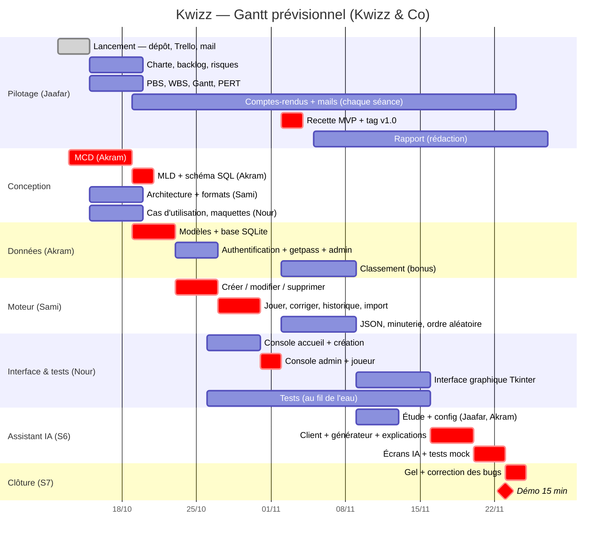
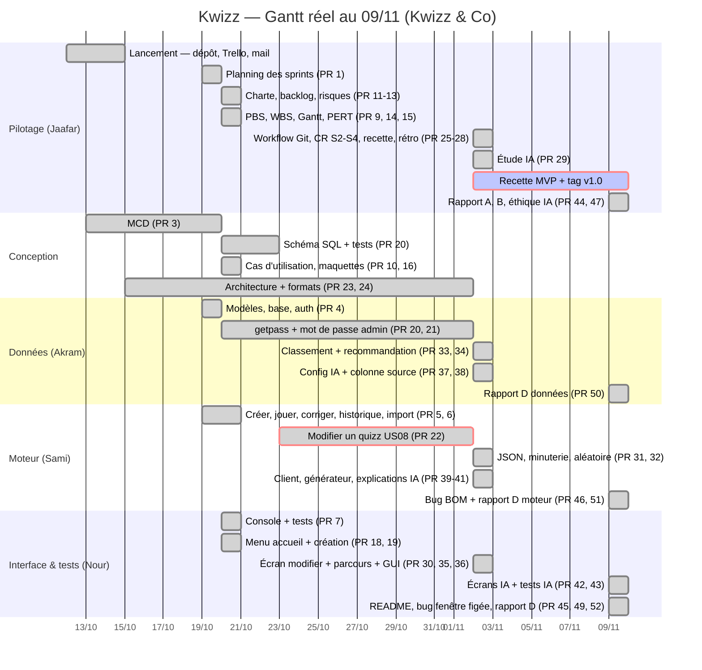

# Gantt prévisionnel et planning des sprints — Kwizz

Hypothèse : **une séance par semaine**, et un sprint = la semaine qui suit la séance. Les dates sont à
ajuster à l'emploi du temps réel. Le détail des 74 tâches (Txx) est dans
[plan-sprints.md](plan-sprints.md).

## Planning des sprints

| Sprint | Séance | Objectif (livrable de fin de sprint) | US visées |
|--------|--------|--------------------------------------|-----------|
| S1 | 12/10 | Équipe, outils et périmètre en place | — |
| S2 | 19/10 | Conception validée : MCD/MLD, architecture, PBS/WBS/Gantt/PERT | — |
| S3 | 26/10 | Comptes utilisateurs et création de quizz | US01–03, US14–15 |
| S4 | 02/11 | **MVP** : jouer, corriger, importer, historique → tag `v1.0-mvp` | US04–08 |
| S5 | 09/11 | Bonus : JSON, minuterie, classement, ordre aléatoire, interface graphique | US09–13 |
| S6 | 16/11 | Assistant IA (optionnel, l'appli marche sans) | US16–19 |
| S7 | 23/11 | Stabilisation, rapport, démo → tag `v2.0-final` | — |

## Diagramme de Gantt

Les barres `crit` (en rouge) correspondent au **chemin critique** du [PERT](PERT.md).

**Corrections de la v1.1 (02/11)** : l'historique (US07) fait partie du MVP, il est donc passé du lot
d3 (après le MVP) au lot m2. La console admin + joueur (i2) finissait le 05/11, après le début de la
recette MVP (02/11) : m1, m2 et i2 sont resserrés pour que i2 se termine le 01/11.

## Gantt réel (mis à jour le 09/11)

Dates de fusion sur `main` (Pull Requests GitHub, numéros entre parenthèses). Le code d'Akram
(getpass, mot de passe admin, schéma SQL) était prêt le 22/10 mais n'a été fusionné que le 02/11.

## Jalons
| Date | Jalon | Preuve |
|------|-------|--------|
| 19/10 | Conception validée | MCD, PBS/WBS/Gantt/PERT dans `docs/` |
| 02/11 | MVP livré | tag `v1.0-mvp` + fiche de recette |
| 16/11 | Fonctions bonus + IA | tableau d'avancement du README |
| 23/11 | Démo + rapport | tag `v2.0-final`, rapport PDF |

## Suivi « prévu vs réel »
À chaque compte-rendu, on note les écarts dans le tableau ci-dessous. En fin de projet, on refait le
Gantt avec les dates **réelles** (annexe du rapport, tâche T68).

| Sprint | Prévu | Réel | Écart | Cause / action |
|--------|-------|------|-------|----------------|
| S1 | équipe, outils, périmètre | dépôt, Trello, mail aux profs faits ; CR-01 non rédigé | CR manquant | rédiger CR-01 à partir du Trello |
| S2 | conception validée | MCD le 19/10 ; PBS, WBS, Gantt, PERT, charte, backlog, risques, cas d'utilisation, maquettes le 20/10 ; diagramme d'architecture absent | +1 j ; architecture en retard | PR ouvertes en fin de séance, fusionnées le lendemain ; Sami pousse l'architecture en S4 |
| S3 | comptes + création | modèles, base, auth, création, jeu, correction, import, historique, console : tout fusionné les 19-20/10 | **en avance d'environ 1 semaine** | le squelette commun a permis de livrer le MVP partie 2 en avance |
| S4 | MVP | US08 fusionné le 02/11 en fin de séance (PR 22, 30), avec getpass et mot de passe admin (code prêt le 22/10) ; dans la même séance : tous les bonus (PR 31-36) et le moteur IA (PR 37-41) ; pas de tag `v1.0-mvp` | MVP livré **à la date du jalon**, mais sans recette ni tag ; bonus et moteur IA **en avance d'1 à 2 semaines** | fusionner les PR le jour même (22 PR le 02/11) ; recette et tag reportés |
| S5 | bonus | bonus déjà livrés en S4 ; le 09/11 : écrans IA + tests IA (PR 42, 43), README (PR 45), 3 bugs corrigés (PR 46, 48, 49), rapport A, B, éthique IA et partie D (PR 44, 47, 50-52) ; 121 tests verts | **en avance d'1 semaine** (IA prévue en S6) ; recette MVP et tag `v1.0-mvp` toujours pas faits | faire la recette sur un clone propre et poser le tag `v1.0-mvp` ; S6 consacrée au rapport (C, E) et à la démo |
| S6 | IA | … | … | … |
